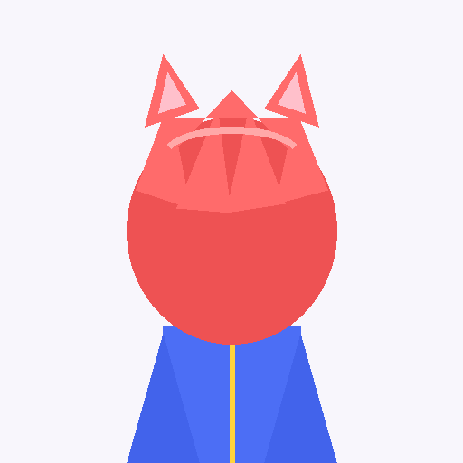

# Prism3D: Image to 3D Smooth Printable Model Studio

An advanced, end-to-end studio to convert **drawings, photos, blueprints, anime art, and cartoons** into smooth, colored, 3D-printable watertight models with real-time interactive 360° inspection and multi-format exports.



---

## ✨ Features

- **Multi-Category Conversion Algorithms**:
  - **Anime & Cartoon Figurine Mode**: Uses Euclidean distance transform and harmonic dome inflation to inflate 2D anime/cartoon characters into smooth 3D rounded figurine toys with facial and clothing relief.
  - **Blueprint & Schematic Extrusion Mode**: Auto-detects blueprint walls and CAD lines on cyan, dark, or white backgrounds; creates solid architectural walls with clean planar tops and solid foundation plates.
  - **Sketch & Line Art Mode**: Turns graphite pencil sketches, ink drawings, and engravings into smooth tactile embossed 3D reliefs.
  - **Photo & Bas-Relief Mode**: Multi-scale frequency decomposition that creates high-detail bas-relief sculptures from continuous-tone photographs.
  - **Lithophane Mode**: Inverse light-density depth mapping with optional cylindrical curved arc framing for backlit 3D prints (lamps and nightlights).
- **Vibrant Color Preservation**:
  - Captures the exact original RGB colors and maps them directly to the 3D surface vertices and textures.
  - Slicers with multi-color capabilities (Bambu Lab AMS, Prusa MMU, OrcaSlicer) and full-color 3D printers (Stratasys J-series, Mimaki) preserve the original colors.
- **100% Watertight & Slicer Ready**:
  - Generates manifold closed solids (top sculpted surface, perimeter boundary skirt walls, flat solid base plate).
  - Ready for zero-hassle slicing in **Bambu Studio, PrusaSlicer, Cura, OrcaSlicer, Chitubox, Anycubic**.
- **Interactive 3D Viewport**:
  - Full 360° rotation (left-click drag), panning (right-click drag), and zooming (mouse wheel).
  - Material preview modes: **Full Color**, **Matte Sculptor Clay**, **Lustrous Gold**, **3D Print Slicer Layer Simulation**, and **Topology Wireframe**.
  - Camera presets (Top, Front, Isometric) and auto-rotate turntable.
  - 200×200mm heated build plate grid visualizer.
- **Multi-Format Export**:
  - **`.STL`**: Industry standard binary STL for all 3D printers.
  - **`.GLB`**: Binary glTF with embedded full-color materials.
  - **`.OBJ`**: Wavefront 3D mesh with vertex colors.
  - **`.PLY`**: Stanford Polygon file with explicit RGB per-vertex color.
- **Command Line Interface (CLI)**:
  - Automate batch conversion via terminal: `python convert_cli.py`.

---

## 🚀 Quick Start

### 1. Launch the Web Studio
Double-click `run.bat` or run:
```bash
python app.py
```
Open your browser to: **http://127.0.0.1:8000**

### 2. Command Line Usage
Convert any image directly from the terminal:
```bash
# Convert Anime Drawing into a 3D GLB model with 16mm depth
python convert_cli.py static/samples/anime_character.png anime_model.glb --mode anime_cartoon --height 16

# Convert Blueprint into a solid 3D printable STL
python convert_cli.py static/samples/architectural_blueprint.png blueprint_model.stl --mode blueprint --width 150 --height 12 --base 3

# Convert Pencil Sketch into an embossed PLY with vertex colors
python convert_cli.py static/samples/pencil_sketch.png sketch_relief.ply --mode sketch_lineart --smoothness 1.0
```

---

## 🖨️ 3D Printing Recommendations

| Printer Type | Recommended Layer Height | Infill | Build Plate Adhesion | Tips |
| :--- | :--- | :--- | :--- | :--- |
| **FDM (Bambu, Prusa, Ender)** | 0.12mm - 0.16mm | 15% Gyroid or Grid | None / Skirt | Flat base adheres firmly to textured PEI plates without brims or rafts. |
| **Multi-Color FDM (AMS / MMU)** | 0.16mm | 15% | None | Load `.obj` or `.glb` directly into Bambu Studio / OrcaSlicer for color painting or height-range filament swaps. |
| **Resin SLA / MSLA** | 0.05mm (50 microns) | Solid / 100% | Flat or 30° tilt with supports | Produces ultra-smooth figurine surfaces and crisp relief details. |
| **Lithophane Prints** | 0.10mm | 100% Rectilinear | Skirt | Print vertically or use white translucent PLA/resin for maximum backlight clarity. |

---

## 📂 Project Structure

```
23D/
├── app.py                      # FastAPI web server and API endpoints
├── convert_cli.py              # Command-line interface for batch conversions
├── generate_samples.py         # Sample image generation utility
├── run.bat                     # Windows one-click launcher
├── converter/
│   ├── __init__.py             # Module exports
│   ├── depth_engine.py         # Specialized depth algorithms (Anime, Blueprint, Photo, etc.)
│   ├── mesh_builder.py         # Watertight manifold mesh construction with vertex colors
│   └── exporter.py             # STL, GLB, OBJ, PLY export handlers
├── static/
│   ├── index.html              # Modern 3D studio dashboard
│   ├── css/style.css           # Glassmorphism dark studio styling
│   ├── js/viewer.js            # Three.js 3D viewport, OrbitControls & shaders
│   ├── js/app.js               # Frontend controller, slider bindings & API calls
│   ├── samples/                # Built-in sample images (Anime, Blueprint, Sketch, Photo)
│   └── vendor/                 # Offline Three.js, OrbitControls, and GLTFLoader
└── temp_models/                # Cached generated 3D models
```
